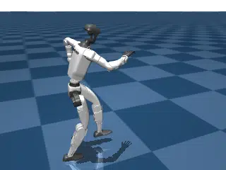
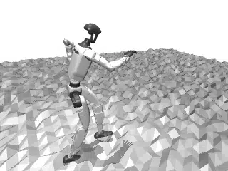
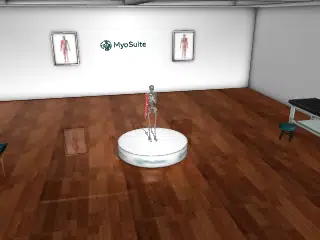
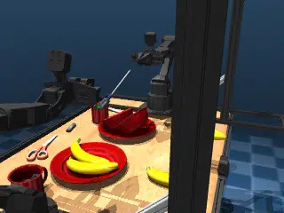
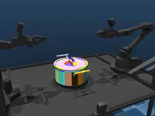
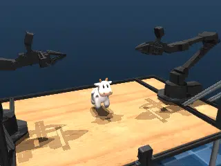
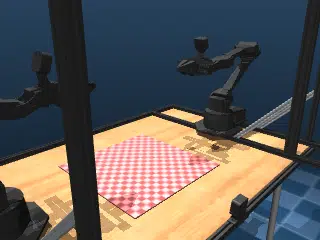
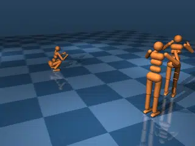
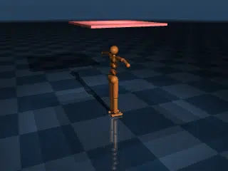

[](https://github.com/google-deepmind/mujoco_warp/actions/workflows/ci.yml?query=branch%3Amain)
[](https://mujoco.readthedocs.io/en/latest/mjwarp/index.html)
[](https://github.com/google-deepmind/mujoco_warp/blob/main/LICENSE)
[](https://google-deepmind.github.io/mujoco_warp/nightly/)

# MuJoCo Warp (MJWarp)

<p align="center">
  <a href="README.md">English</a> · <b>简体中文</b>
</p>

MJWarp 是 [MuJoCo](https://github.com/google-deepmind/mujoco) 物理仿真引擎专为 NVIDIA 硬件打造的 GPU 硬件级加速版本。MJWarp 为机器人学前沿研究提供超高吞吐量与高精度的物理仿真。

MJWarp 由 [Google DeepMind](https://deepmind.google/) 与 [NVIDIA](https://www.nvidia.com/) 联合维护，是 [Newton](https://github.com/newton-physics/newton) 项目的核心组成部分。

## 快速入门 (Getting started)

MuJoCo Warp 需要配备 NVIDIA GPU 才能实现高速仿真，同时也完整支持 CPU 运行以便于本地开发与调试。

**即刻体验：** 在你的本地机器上查看跳舞人形机器人的实时仿真：

```bash
git clone https://github.com/google-deepmind/mujoco_warp.git && cd mujoco_warp
python benchmarks/run.py -f unitree_g1_flat --view
```

或者直接在浏览器中体验[入门教程 Colab Notebook](https://colab.research.google.com/github/google-deepmind/mujoco_warp/blob/main/notebooks/tutorial.ipynb)（无需本地配置环境）。

MJWarp 亦可通过 PyPI 直接安装：

```bash
pip install mujoco-warp
```

## 仿真示例 (Examples)

MuJoCo Warp 支持对多种物理系统进行仿真模拟，从带碰撞接触的刚体，到软体（Soft bodies）、布料（Cloth）、符号距离场（SDF, Signed Distance Fields）等。以下是部分仿真能力展示：

<table>
  <tr>
    <td align="center" width="33%">
      
      <br><b>python benchmarks/run.py -f unitree_g1_flat --view</b>
    </td>
    <td align="center" width="33%">
      
      <br><b>python benchmarks/run.py -f unitree_g1_hfield --view</b>
    </td>
    <td align="center" width="33%">
      
      <br><b>python benchmarks/run.py -f myoarm --view</b>
    </td>
  </tr>
  <tr>
    <td align="center" width="33%">
      
      <br><b>python benchmarks/run.py -f aloha_clutter --view</b>
    </td>
    <td align="center" width="33%">
      
      <br><b>python benchmarks/run.py -f aloha_pot --view</b>
    </td>
    <td align="center" width="33%">
      
      <br><b>python benchmarks/run.py -f aloha_sdf --view</b>
    </td>
  </tr>
  <tr>
    <td align="center" width="33%">
      
      <br><b>python benchmarks/run.py -f aloha_cloth --view</b>
    </td>
    <td align="center" width="33%">
      
      <br><b>python benchmarks/run.py -f three_humanoids --view</b>
    </td>
    <td align="center" width="33%">
      
      <br><b>python benchmarks/run.py -f cloth --view</b>
    </td>
  </tr>
</table>

上述每个基准场景均在每日夜间自动执行评测，并[公开发布夜间基准测试结果 (Nightly Benchmarks)](https://google-deepmind.github.io/mujoco_warp/nightly/)。

## 开发者指南 (Tips for developers)

配置 MJWarp 本地开发环境：

```bash
git clone https://github.com/google-deepmind/mujoco_warp.git && cd mujoco_warp
uv sync --all-extras  # 安装用于开发的全套可选依赖项
uv run pre-commit install  # 在 commit 时启用 ruff、uv-lock 与 kernel-analyzer 静态检查
uv run pytest -n 8  # 并行运行全部测试，验证环境完好
```

如果您计划为 MJWarp 编写 Warp 算子（Kernels），请使用位于 [`contrib/kernel_analyzer`](https://github.com/google-deepmind/mujoco_warp/tree/main/contrib/kernel_analyzer) 的 `kernel_analyzer` VSCode 插件。有关如何安装与使用的详细信息，请参阅该目录下的 [README](https://github.com/google-deepmind/mujoco_warp/blob/main/contrib/kernel_analyzer/README.md)。相同的内核分析器将在你提交的任何 PR 上自动运行，因此请务必修复其报告的任何潜在问题。

如需对 MJWarp 进行性能分析与剖析（Profiling），可在 `mjwarp-testspeed` 上使用 `--event_trace` 参数，以获取所选测试场景的完整执行追踪报告：

```bash
mjwarp-testspeed benchmarks/humanoid/humanoid.xml --event_trace
```

`mjwarp-testspeed` 提供了丰富的配置选项，详情可通过 `mjwarp-testspeed --help` 查看。关于使用 MJWarp 的更多细节与高阶主题，请参阅 [MuJoCo Warp 官方文档](https://mujoco.readthedocs.io/en/latest/mjwarp/index.html)。

## 集成 MuJoCo Warp (Integrating MuJoCo Warp)

在项目中集成 MuJoCo Warp 有多种方式。在大多数场景下，你可以直接安装并将 MJWarp 作为 MuJoCo 的即插即用替代品。

如果你更习惯使用 [JAX](https://github.com/jax-ml/jax) 生态，可以通过 [MJX](https://mujoco.readthedocs.io/en/stable/mjx.html) 使用 MJWarp。参阅 [MuJoCo Playground](https://github.com/google-deepmind/mujoco_playground) 获取基于 [JAX](https://github.com/jax-ml/jax) 与 MJWarp 的机器人机器学习配方。

如果你偏好在科研中使用 [PyTorch](https://pytorch.org/)，可以考虑以下两个优秀方案：

* [Isaac Lab](https://github.com/isaac-sim/IsaacLab/tree/feature/newton) 通过 [Newton](https://github.com/newton-physics/newton) 集成了 MJWarp。该方案依托深度 NVIDIA 生态集成，支持强大且高度可扩展的多物理场仿真。
* [mjlab](https://github.com/mujocolab/mjlab) 直接在 MJWarp 之上暴露了 [Isaac Lab](https://github.com/isaac-sim/IsaacLab) 基于管理器的 API（Manager-based API），为机器人研究提供了轻量级依赖、可直接访问原生 MuJoCo 数据结构的专注框架。

## MuJoCo API 兼容性 (MuJoCo API Compatibility)

MuJoCo Warp 支持与原生 MuJoCo 相同的绝大多数特性，但有以下例外：

- **积分器 (Integrator)**：暂不支持 `IMPLICITFAST` 中点积分器特性
- **求解器 (Solver)**：暂不支持 `PGS`（`discrete` 积分器下暂不支持 `noslip`）
- **执行器 / 传感器 (Actuator / Sensors)**：暂不支持 `PLUGIN` 自定义插件类型
- **柔性体 (Flex)**：处于实验性阶段 —— 尚未实现或优化全部特性

通过 Warp 进行的可微物理仿真（[Differentiability via Warp](https://nvidia.github.io/warp/user_guide/differentiability.html)）目前尚不可用，开发进展请关注 Issue [#500](https://github.com/google-deepmind/mujoco_warp/issues/500)。

## 批量渲染 (Batch Rendering)

MJWarp 内置了**超高吞吐量**的 GPU 批量渲染器，专为跨众多并行仿真世界的相机同时渲染而设计。该渲染器基于光线追踪技术，在 NVIDIA GPU 上渲染 MuJoCo 场景的帧率可达数百万 FPS。

核心功能包括：
- 网格渲染 (Mesh rendering)
- 纹理材质支持 (Texture support)
- 高度场渲染 (Heightfield rendering)
- 柔性体形变渲染 (Flex deformable rendering)
- 高斯泼溅渲染 (Gaussian splat rendering)
- 异构多相机支持 (每台相机可配置不同分辨率 / 视场角 FOV / 内参)
- 光照与阴影支持

更多详细信息，请参阅[官方发布 PR](https://github.com/google-deepmind/mujoco_warp/pull/1113)。

## 开源协议 (License)

MJWarp 基于 Apache 2.0 协议发布。详情请参阅 [LICENSE](LICENSE) 文件。

---

> **翻译说明（Translation Disclaimer）**
> 本文档由社区志愿者（[@JasonYeYuhe](https://github.com/JasonYeYuhe)）人工翻译并维护，旨在降低中文开发者的阅读门槛。最后同步日期：2026年10月21日。若译文与英文原版存在任何出入或滞后，请以 [英文原版 (README.md)](README.md) 为准。欢迎通过 PR 协助改进译文！
