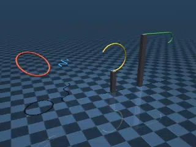
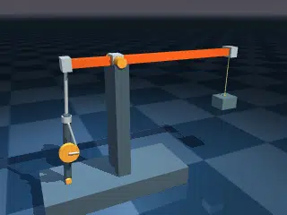
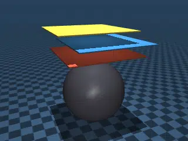
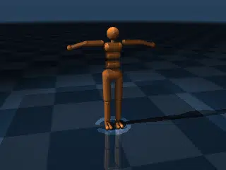
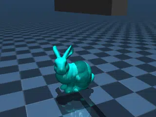
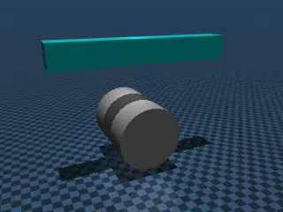
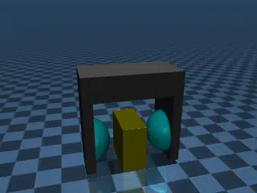
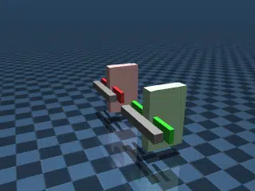
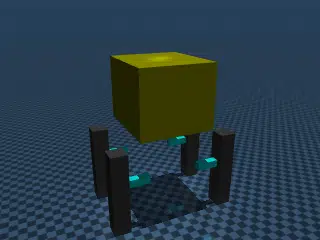
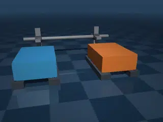

# Flex

## Description

Deformables sourced from [MuJoCo `model/flex`](https://github.com/google-deepmind/mujoco/tree/8b76151a21e003925626ffbe3b7d325a35246b50/model/flex) and [`model/plastic`](https://github.com/google-deepmind/mujoco/tree/8b76151a21e003925626ffbe3b7d325a35246b50/model/plastic), exercising 1D elastic rods, 2D cloth and shells, and 3D volumetric elastic and elasto-plastic soft bodies under the discrete integrator and [MuJoCo deformable objects](https://mujoco.readthedocs.io/en/stable/modeling.html#deformable-objects).

### flex_curved_rods

Four 1D discrete elastic rods (a closed ring, a planar wave, a pinned arc, and a pinned hook) with bending, torsion, inextensible edge equalities, and ground contact.

| Property | Value |
|----------|-------|
| Bodies | 130 |
| DoFs | 283 |
| Actuators | 0 |
| Geoms | 3 |
| Timestep | 0.002s |
| Solver | Newton |
| Friction | Pyramidal |
| Integrator | Discrete |
| Matrix Format | Sparse |

### flex_dipper

A cylinder-driven flexible dipper arm mechanism modeled as a 1D box-section rod coupled to rigid linkages via connect and joint equalities, carrying a tendon-suspended payload.

| Property | Value |
|----------|-------|
| Bodies | 51 |
| DoFs | 106 |
| Actuators | 1 |
| Geoms | 17 |
| Timestep | 0.001s |
| Solver | Newton |
| Friction | Pyramidal |
| Integrator | Discrete |
| Matrix Format | Sparse |

### flex_drape

Three stacked 13×13 2D cloths dropped over a sphere with passive flex self-collision, layer-to-layer contact, and sphere contact.

| Property | Value |
|----------|-------|
| Bodies | 508 |
| DoFs | 1521 |
| Actuators | 0 |
| Geoms | 2 |
| Timestep | 0.002s |
| Solver | Newton |
| Friction | Pyramidal |
| Integrator | Discrete |
| Matrix Format | Sparse |

### flex_poncho

A 2D triangular cloth mesh with stretch and bending elasticity draped over a rigid humanoid mannequin.

| Property | Value |
|----------|-------|
| Bodies | 502 |
| DoFs | 1458 |
| Actuators | 0 |
| Geoms | 21 |
| Timestep | 0.005s |
| Solver | Newton |
| Friction | Pyramidal |
| Integrator | Discrete |
| Matrix Format | Sparse |

### flex_bunny_shell

A 2D trilinearly interpolated shell (`dof="trilinear"`, `elastic2d="bend"`, `equality="strain"`) embedded on a 4,968-triangle Stanford Bunny surface mesh, compressed by an overhead press plate (`bunny_shell.npz`) and released.

| Property | Value |
|----------|-------|
| Bodies | 58 |
| DoFs | 169 |
| Actuators | 1 |
| Geoms | 2 |
| Timestep | 0.002s |
| Solver | CG |
| Friction | Pyramidal |
| Integrator | Discrete |
| Matrix Format | Sparse |

### flex_floppy

A 24×4×4 3D tetrahedral soft body (1,242 tetrahedra) dropping onto a hinged cylinder.

| Property | Value |
|----------|-------|
| Bodies | 386 |
| DoFs | 1153 |
| Actuators | 1 |
| Geoms | 2 |
| Timestep | 0.001s |
| Solver | Newton |
| Friction | Pyramidal |
| Integrator | Discrete |
| Matrix Format | Sparse |

### flex_gripper

A parallel gripper with two pinned 3D tetrahedral compliant pads grasping and lifting a rigid box with elliptic friction (`gripper.npz`).

| Property | Value |
|----------|-------|
| Bodies | 351 |
| DoFs | 1047 |
| Actuators | 2 |
| Geoms | 5 |
| Timestep | 0.002s |
| Solver | Newton |
| Friction | Elliptic |
| Integrator | Discrete |
| Matrix Format | Sparse |

### flex_hollow_vs_solid

Two grippers squeezing a pair of 3D trilinearly interpolated blocks (`hollow_vs_solid.npz`): a solid volume (`elastic2d="none"`) alongside a hollow bending shell (`elastic2d="bend"`), both with strain equality constraints and elliptic friction.

| Property | Value |
|----------|-------|
| Bodies | 205 |
| DoFs | 594 |
| Actuators | 4 |
| Geoms | 7 |
| Timestep | 0.002s |
| Solver | Newton |
| Friction | Elliptic |
| Integrator | Discrete |
| Matrix Format | Sparse |

### flex_strain

Four pinned 3D trilinearly interpolated soft pads supporting a falling rigid box with `mjEQ_FLEXSTRAIN` equality constraints and elliptic friction.

| Property | Value |
|----------|-------|
| Bodies | 22 |
| DoFs | 54 |
| Actuators | 0 |
| Geoms | 6 |
| Timestep | 0.002s |
| Solver | Newton |
| Friction | Elliptic |
| Integrator | Discrete |
| Matrix Format | Sparse |

### flex_roller

A spring-driven geared ribbed roller pressing across a pair of 3D trilinearly interpolated slabs (one elastic, one elasto-plastic with yield stress) under CG + discrete integration.

| Property | Value |
|----------|-------|
| Bodies | 266 |
| DoFs | 794 |
| Actuators | 0 |
| Geoms | 12 |
| Timestep | 0.003s |
| Solver | CG |
| Friction | Pyramidal |
| Integrator | Discrete |
| Matrix Format | Sparse |

## Creation steps

1. Each benchmark assembles the upstream [`model/flex`](https://github.com/google-deepmind/mujoco/tree/8b76151a21e003925626ffbe3b7d325a35246b50/model/flex) or [`model/plastic`](https://github.com/google-deepmind/mujoco/tree/8b76151a21e003925626ffbe3b7d325a35246b50/model/plastic) directory directly from the pinned [`google-deepmind/mujoco`](https://github.com/google-deepmind/mujoco) revision in `__init__.py` without duplicating MJCF or mesh assets in this repository.
2. Passive scenes (`flex_curved_rods`, `flex_drape`, `flex_poncho`, `flex_floppy`, `flex_strain`, `flex_roller`) and the self-driving `flex_dipper` mechanism run with zero control input and their upstream XML options (with `opt.iterations=1000` overridden on `flex_drape`).
3. Actuated manipulation scenes include open-loop control trajectories: `bunny_shell.npz` lowers and releases the overhead press plate, `gripper.npz` closes the compliant pads and lifts the rigid box, and `hollow_vs_solid.npz` repeatedly squeezes and releases both trilinear blocks.

## License

[LICENSE](LICENSE) contains the upstream Apache-2.0 license for [MuJoCo flex model assets (`model/flex/` and `model/plastic/`)](https://github.com/google-deepmind/mujoco/tree/main/model/flex) and the Stanford Computer Graphics Laboratory attribution for `asset/bunny.obj`.
