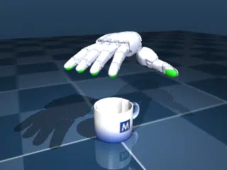

# Sharpa Wave

## Description

A [Sharpa Wave](https://github.com/google-deepmind/mujoco_menagerie/tree/370c43965323c0944b433b202aac5058b5f907a9/sharpa_wave) right hand with five fingertip `<tactile>` sensors reaches down palm-down, grasps a [MuJoCo mug](https://github.com/google-deepmind/mujoco/tree/4eb987ad2557cf448fc2b61473bb6409b68e50eb/model/mug) with all five fingers, and lifts it off the ground plane. This benchmark exercises multi-fingered dexterous manipulation and GPU tactile sensor evaluation (`_sensor_tactile`) across 3562 elastomer surface taxels per world.

### sharpa_wave

| Property | Value |
|----------|-------|
| Bodies | 27 |
| DoFs | 34 |
| Actuators | 28 |
| Geoms | 117 |
| Sensors | 5 (3562 taxels) |
| Timestep | 0.002s |
| Solver | Newton |
| Friction | Elliptic |
| Integrator | Implicit Fast |
| Matrix Format | Sparse |

## Creation steps

1. **Hand and mug models**: The hand is derived from [`sharpa_wave/right_hand.xml`](https://github.com/google-deepmind/mujoco_menagerie/blob/370c43965323c0944b433b202aac5058b5f907a9/sharpa_wave/right_hand.xml) in MuJoCo Menagerie with a 6-DoF position-actuated wrist oriented palm-down above the ground plane, and the mug is adapted from [`model/mug/mug.xml`](https://github.com/google-deepmind/mujoco/blob/4eb987ad2557cf448fc2b61473bb6409b68e50eb/model/mug/mug.xml). External meshes and textures are fetched automatically from the pinned revisions in `__init__.py`.
2. **Elastomer tactile mesh post-processing**: Upstream Menagerie elastomer meshes (`elastomer_HB1_TH.stl` and `elastomer_HB1_4F.stl`) are dense, closed watertight CAD shells that include non-sensing mounting walls. To match the hardware UV camera sensing surface, open-surface meshes (`elastomer_tactile_TH`: 710 vertices, 1329 faces; `elastomer_tactile_4F`: 713 vertices, 1336 faces) were built from the 240×240 calibrated UV point and normal maps (`wave_01/tactileSensor_map_{TH,4F}_{point,normal}.npy`) in [`sharpa-tactile-sensor-assets`](https://github.com/sharpa-robotics/sharpa-tactile-sensor-assets/tree/e628d93b03ac15aa8b7b89769e05ac3528b86451) by:
   - Subsampling the 240×240 UV grid with `step=8` (30×30 grid, matching [`sharpa-rl-lab`](https://github.com/sharpa-robotics/sharpa-rl-lab)) and keeping valid non-zero taxels.
   - Triangulating valid 2×2 UV grid quads into an open surface mesh with per-vertex outward normals.
   - Transforming from the sensor frame (mm) into the Menagerie distal phalanx frame (m) via a 180° z-rotation `(-x, -y, z) * 1e-3` and embedding the meshes inline in `scene.xml`.
3. **Fingertip collision post-processing**: Upstream fingertip collision capsules protrude up to 2.2 mm outside the elastomer surfaces, blocking rigid objects from reaching the tactile meshes. The `right_*_fingertip_collision` capsules on `right_*_DP` were refit ~0.8–1.0 mm inside the outer UV elastomer surface (`size="0.007515 0.004844"` on the thumb and `size="0.006299 0.007098"` on the four fingers) to model ~1 mm of compliant elastomer compression before rigid contact.
4. **Control replay**: The 2.0-second trajectory in `grasp_mug.npz` (1000 steps at `0.002s`) lowers the hand over the mug, closes all five fingers around the cylindrical wall to engage all five tactile sensors, and lifts the mug off the ground plane.

## License

[Sharpa Wave hand](https://github.com/google-deepmind/mujoco_menagerie/blob/370c43965323c0944b433b202aac5058b5f907a9/sharpa_wave/LICENSE), [Sharpa Tactile Sensor Assets](https://github.com/sharpa-robotics/sharpa-tactile-sensor-assets/tree/e628d93b03ac15aa8b7b89769e05ac3528b86451), and the [MuJoCo mug model](https://github.com/google-deepmind/mujoco/blob/4eb987ad2557cf448fc2b61473bb6409b68e50eb/LICENSE).
